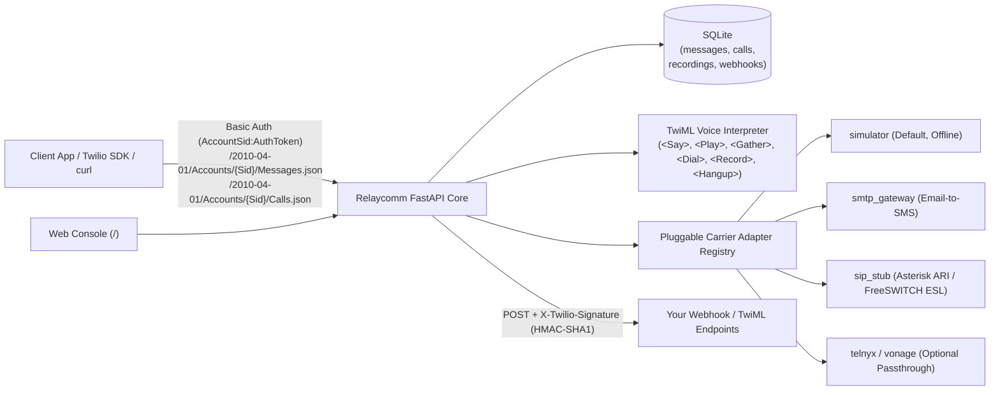

# Relaycomm

[](https://github.com/kfairley9999/relaycomm/actions/workflows/tests.yml)
[](LICENSE)

**Relaycomm** is a self-hosted, open-source programmable SMS and Voice API that mirrors Twilio's REST shape. It is a control plane you can run locally or on your own server: develop Twilio-compatible messaging and TwiML voice workflows against an offline simulator, then plug in a carrier or SIP trunk later if you need real public-telephone delivery.

It is **not** a Twilio product, and it does **not** reach real phone numbers unless you attach a carrier or SIP trunk. That path is not configured in this repository.

## What it is

A FastAPI application with SQLite storage, HTTP Basic Auth (`AccountSid` + `AuthToken`), Twilio-style resource SIDs (`SM…`, `CA…`, `RE…`), signed status callbacks, a TwiML voice interpreter, a small web console, and pluggable carrier adapters.

## Features

- **Twilio-compatible REST API** under `/2010-04-01/Accounts/{AccountSid}/…`
  - Messages: `POST` / `GET /Messages.json`, `GET` / `DELETE /Messages/{Sid}.json` (`SM…` SIDs, form-encoded or JSON bodies, segment counting, `To` / `From` filters)
  - Calls: `POST` / `GET /Calls.json`, `GET` / `POST /Calls/{Sid}.json`, `GET /Calls/{Sid}/Trace.json`, `GET /Calls/{Sid}/Recordings.json` (`CA…` and `RE…` SIDs)
  - HTTP Basic Auth with constant-time credential comparison and a path `AccountSid` check
- **Signed webhooks** using the same HMAC-SHA1 construction as `X-Twilio-Signature` (URL + sorted POST params), plus an `X-Relaycomm-Signature` alias. Status callbacks, TwiML fetches, `<Gather>` / `<Record>` actions, and simulated inbound events are logged in SQLite.
- **TwiML voice interpreter** (`defusedxml`, with XXE blocked and a max redirect depth of 10): `<Say>`, `<Play>`, `<Gather>` (nested prompts, `SimulatedDigits`, signed `action` callbacks), `<Dial>` (`<Number>`, `<Sip>`, `<Client>`), `<Record>`, `<Pause>`, `<Redirect>`, and `<Hangup/>`.
- **Pluggable carrier adapters**
  - `simulator` *(default)*: 100% offline; records SMS in SQLite and executes TwiML locally
  - `smtp_gateway`: SMTP email-to-SMS (for example `vtext.com`, `txt.att.net`, `tmomail.net`, or a local Mailpit sink)
  - `sip_stub`: documented Asterisk ARI / FreeSWITCH ESL originate payloads (dry-run unless a live PBX is wired up)
  - `telnyx` and `vonage`: optional HTTP passthrough adapters, disabled unless selected with API keys
- **SQLite storage** (WAL mode) for accounts, messages, calls, recordings, and webhook deliveries
- **Local web console** at `/` to inspect logs and trigger simulated outbound or inbound SMS and TwiML calls
- **Docker Compose** and a `Dockerfile` for a one-command local server

## Architecture



## Quickstart (local)

Requires Python 3.11+.

```bash
git clone https://github.com/kfairley9999/relaycomm.git
cd relaycomm
python -m venv .venv
source .venv/bin/activate
pip install -e ".[dev]"
cp .env.example .env
python -m relaycomm.app
```

Then open [http://localhost:8080/](http://localhost:8080/) for the web console, or [http://localhost:8080/health](http://localhost:8080/health) for a health check.

Default development credentials (change these in production; they are placeholders only):

- Account SID: `AC00000000000000000000000000000001`
- Auth token: `dev_auth_token_change_me`

## Quickstart (Docker Compose)

```bash
docker compose up --build
```

To also start a local Mailpit SMTP sink on `localhost:1025` (web UI at [http://localhost:8025](http://localhost:8025)) for testing `RELAYCOMM_ADAPTER=smtp_gateway`:

```bash
docker compose --profile smtp up --build
```

## Tests

12 pytest tests cover HMAC signature construction, auth, message CRUD and signed status callbacks, TwiML verb execution and recordings, remote `<Gather>` flows, XXE / redirect limits, inbound simulation, the SMTP gateway, the SIP stub payloads, and Telnyx/Vonage passthrough (mocked HTTP, no live carrier calls).

```bash
pytest -v
```

## Usage examples

### curl

```bash
ACCOUNT_SID=AC00000000000000000000000000000001
AUTH_TOKEN=dev_auth_token_change_me

curl -X POST "http://localhost:8080/2010-04-01/Accounts/${ACCOUNT_SID}/Messages.json" \
  -u "${ACCOUNT_SID}:${AUTH_TOKEN}" \
  --data-urlencode "From=+15550100001" \
  --data-urlencode "To=+15550109999" \
  --data-urlencode "Body=Hello from Relaycomm"
```

See `examples/curl_examples.sh` and `examples/python_sdk_snippet.py` for SMS, Voice TwiML, and an optional official Twilio Python SDK example that rewrites `api.twilio.com` to a self-hosted Relaycomm base URL.

### Verifying `X-Twilio-Signature` in Python

```python
from relaycomm.security import verify_twilio_signature

is_valid = verify_twilio_signature(
    auth_token="dev_auth_token_change_me",
    url="http://localhost:9000/webhook",
    params=dict(form_data),
    signature=request.headers["X-Twilio-Signature"],
)
```

## Limitations (real PSTN delivery)

Relaycomm is an API and TwiML control plane plus a local simulator. **It does not deliver SMS or voice to the public telephone network out of the box.** Reaching real mobile or landline phones requires a carrier or SIP trunk, which is not configured here:

1. **Self-hosted PBX + SIP trunk:** run Asterisk or FreeSWITCH (both open source) and attach a paid SIP trunk plus DID numbers, then wire them through the `sip_stub` adapter.
2. **Carrier passthrough:** fund a Telnyx or Vonage account and set `RELAYCOMM_ADAPTER=telnyx` or `vonage` with API keys in `.env`.

Additional constraints:

- Real U.S. A2P SMS also needs 10DLC brand/campaign registration, leased DIDs, and per-segment usage fees.
- The `smtp_gateway` path depends on carrier email-to-SMS gateways. Delivery receipts are unreliable, bulk mail can be throttled, and you generally need to know the recipient's carrier.
- In `simulator` mode, `<Say>`, `<Play>`, and `<Record>` simulate timing, write `RE…` metadata, and fire callbacks. They do not encode or stream real PCM/RTP audio.
- Storage is single-node SQLite, which is fine for local and small self-hosted use. Multi-worker high concurrency would need a different database.

## License

MIT. See [LICENSE](LICENSE).
