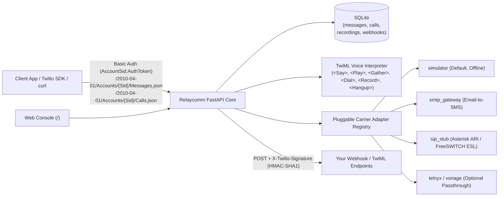

# Relaycomm

**Relaycomm** is a self-hosted, open-source, Twilio-compatible programmable SMS and Voice API built with FastAPI, SQLite, and `defusedxml`. It lets you develop, test, and run Twilio-shaped messaging and TwiML voice workflows locally or on your own server, with pluggable carrier adapters and an offline simulator.

## Architecture



## Features

- **Twilio-compatible REST API (`/2010-04-01/Accounts/{AccountSid}/...`)**:
  - `POST/GET /Messages.json` and `GET/DELETE /Messages/{Sid}.json` (`SM...` SIDs, form-encoded or JSON, segment counting, `To`/`From` filtering)
  - `POST/GET /Calls.json`, `GET/POST /Calls/{Sid}.json`, `GET /Calls/{Sid}/Trace.json`, and `GET /Calls/{Sid}/Recordings.json` (`CA...` and `RE...` SIDs)
  - HTTP Basic Auth (`AccountSid` + `AuthToken`) with constant-time verification
- **Signed Webhooks (`X-Twilio-Signature`)**:
  - Exact HMAC-SHA1 signature over `URL + sorted POST params` (and `X-Relaycomm-Signature` alias)
  - Every status callback, TwiML fetch, `<Gather>` action, `<Record>` action, and simulated inbound event is logged in SQLite
- **TwiML Voice Interpreter (`defusedxml`)**:
  - Supports `<Say>`, `<Play>`, `<Gather>` (with nested `<Say>`/`<Play>` and `action` callback), `<Dial>` (`<Number>`, `<Sip>`, `<Client>`), `<Record>`, `<Pause>`, `<Redirect>`, and `<Hangup/>`
- **Pluggable Carrier Adapters**:
  - `simulator` *(default)*: 100% offline, deterministic delivery and TwiML execution
  - `smtp_gateway`: sends SMS via SMTP email-to-SMS carrier gateways (e.g., `vtext.com`, `txt.att.net`, `tmomail.net`, or Mailpit locally)
  - `sip_stub`: documented Asterisk ARI / FreeSWITCH ESL adapter stub generating real originate payloads
  - `telnyx` & `vonage`: optional HTTP passthrough adapters (disabled unless selected with API keys)
- **Local Web Console (`/`)**:
  - Inspect messages, calls, TwiML step traces, recordings, signed webhooks, and trigger simulated SMS/calls from the browser

## Quickstart (Local)

```bash
cd /workspace/twilio-clone
cp .env.example .env
uv pip install --python .venv/bin/python -e ".[dev]"
.venv/bin/python -m relaycomm.app
```

Open **http://localhost:8080/** for the Web Console, or check **http://localhost:8080/health**.

Run tests:

```bash
.venv/bin/pytest
```

## Quickstart (Docker Compose)

```bash
docker compose up --build
```

To also launch a local Mailpit SMTP sink on `localhost:1025` (Web UI on `http://localhost:8025`) for testing `RELAYCOMM_ADAPTER=smtp_gateway`:

```bash
docker compose --profile smtp up --build
```

## Usage Examples

### curl

```bash
ACCOUNT_SID=AC00000000000000000000000000000001
AUTH_TOKEN=dev_auth_token_change_me

curl -X POST "http://localhost:8080/2010-04-01/Accounts/${ACCOUNT_SID}/Messages.json" \
  -u "${ACCOUNT_SID}:${AUTH_TOKEN}" \
  --data-urlencode "From=+15550100001" \
  --data-urlencode "To=+15550109999" \
  --data-urlencode "Body=Hello from Relaycomm"
```

See `examples/curl_examples.sh` and `examples/python_sdk_snippet.py` for full SMS, Voice TwiML, and official Twilio Python SDK integration examples.

### Verifying `X-Twilio-Signature` in Python

```python
from relaycomm.security import verify_twilio_signature

is_valid = verify_twilio_signature(
    auth_token="dev_auth_token_change_me",
    url="http://localhost:9000/webhook",
    params=dict(form_data),
    signature=request.headers["X-Twilio-Signature"],
)
```

## Honest Limitations (What's Needed to Go Live)

1. **No real PSTN connectivity out of the box**: Relaycomm is an API/TwiML control plane and local simulator. Reaching real mobile/landline phones requires either:
   - A self-hosted SIP PBX (**Asterisk** or **FreeSWITCH**, both free/open-source) paired with a **paid SIP trunk** (e.g., Telnyx, VoIP.ms, Bandwidth, Flowroute) and DID phone numbers, or
   - Enabling the `telnyx` / `vonage` passthrough adapter with a funded carrier account.
2. **SMS compliance & carrier fees**: Real US A2P SMS requires carrier registration (10DLC campaign/brand approval), DID leases (~$1/mo/number), and per-segment usage fees.
3. **`smtp_gateway` caveats**: Free carrier email-to-SMS gateways (`@vtext.com`, `@txt.att.net`, etc.) do not provide reliable delivery receipts, can throttle bulk mail, and require knowing or guessing the recipient's carrier.
4. **No live RTP/audio media streaming in `simulator`**: `<Say>`, `<Play>`, and `<Record>` simulate timing, create `RE...` metadata rows, and invoke callbacks, rather than encoding/streaming real PCM/RTP audio.
5. **Single-node SQLite**: Great for self-hosted/dev/small workloads; for multi-worker high concurrency, swap `db.py` for PostgreSQL.
